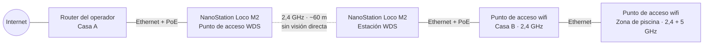
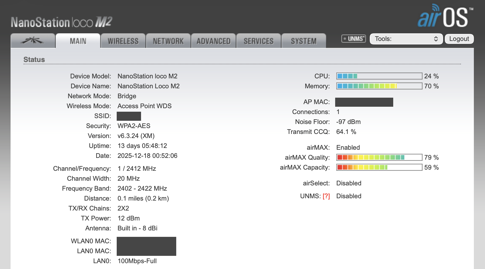
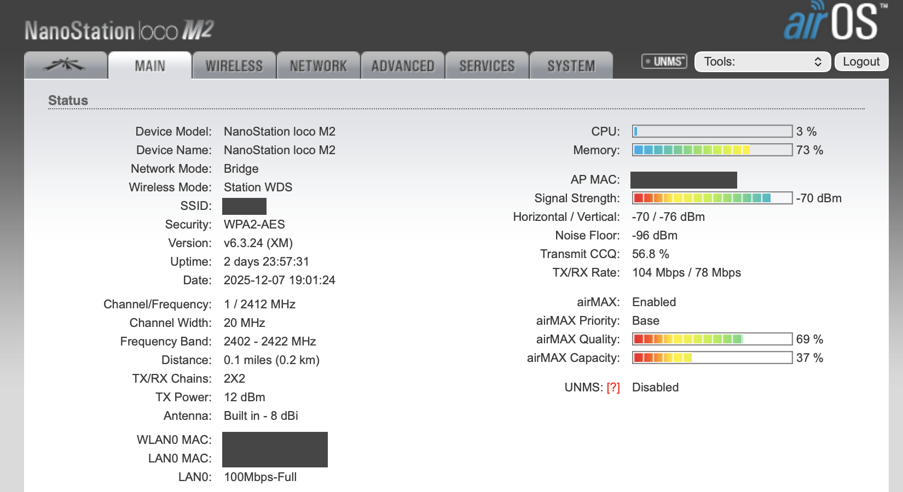
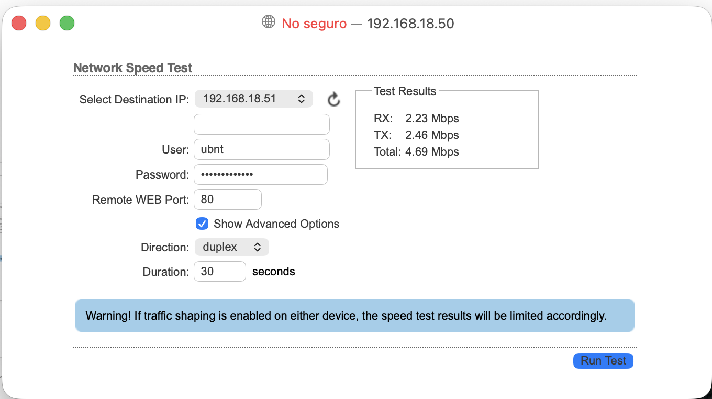
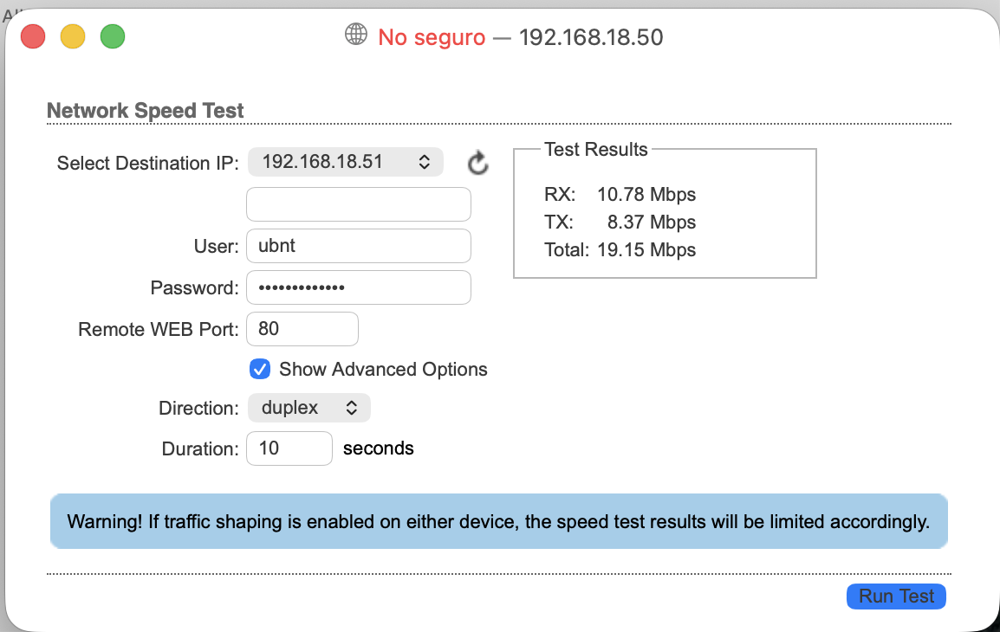
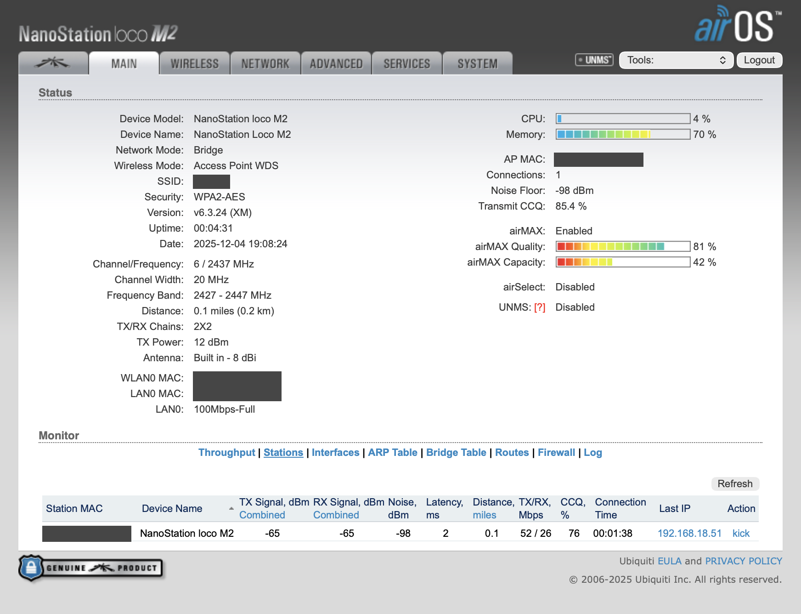
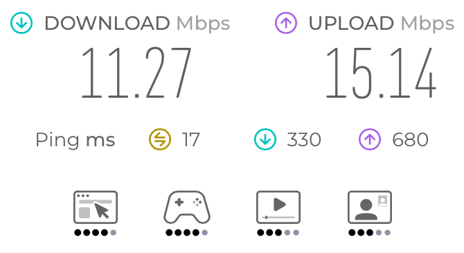
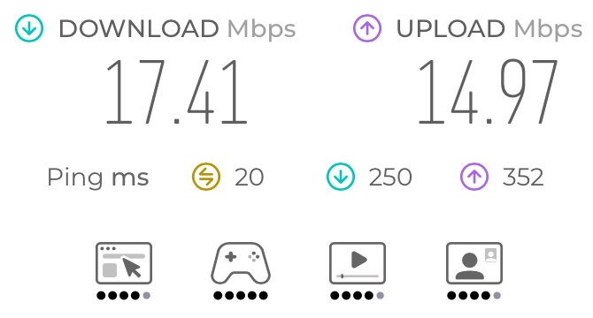

# Radioenlace punto a punto sin visión directa

Enlace inalámbrico de 2,4 GHz que lleva la conexión a Internet de una vivienda a otra situada a unos 60 m en la misma calle, **sin visión directa** entre las antenas. El enlace llevaba años funcionando, pero en 2026 dejó de hacerlo y tuve que recuperarlo y reconfigurarlo por completo. Después lo diagnostiqué y lo optimicé: un cambio de canal, decidido a partir de mediciones, **multiplicó hasta por cuatro su rendimiento**.

## El problema

- La conexión a Internet (fibra) está contratada en la **casa A**. La **casa B** no tiene conexión propia.
- Entre las dos casas no hay visión directa: la calle hace una ligera curva y la fachada de la casa A está retranqueada para dejar un porche delante.
- En verano de 2026 el enlace dejó de funcionar porque se rompió el cable que iba de la antena de la casa B al router. Era un cable de interior instalado en la fachada y no aguantó la intemperie.
- Al repararlo, ya no se conocían las credenciales de ninguno de los equipos, y además se cambiaron los routers de las dos casas, así que hubo que **reconfigurarlo todo desde cero**.

## Esquema de red

Las dos antenas funcionan en **modo puente** (bridge) y los dos routers de la casa B están configurados como **puntos de acceso**. Toda la instalación es **una única red**: un dispositivo conectado en la casa B o en la piscina recibe su dirección IP del router de la casa A, como si estuviera allí. No hay doble NAT.

## Material

| Elemento | Detalle |
|---|---|
| Antenas | 2 × Ubiquiti NanoStation Loco M2 (2,4 GHz, MIMO 2x2, antena integrada de 8 dBi) |
| Alimentación | Inyectores PoE pasivos de 24 V |
| Cableado | Cable Ethernet Cat 6 UTP de exterior, cobre rígido (casa B y tramo hasta la piscina) |
| Firmware | airOS v6.3.24 (XM) |
| Router casa A | Huawei EG8147X6 (ONT de fibra del operador) |
| Punto de acceso casa B | ASUS RT-AC51U (doble banda); antes, Movistar Home Station BHS-RTA (2015, solo 2,4 GHz) |
| Punto de acceso piscina | Se desconecta en invierno |

## Configuración

| Parámetro | Casa A | Casa B |
|---|---|---|
| Modo inalámbrico | Punto de acceso WDS | Estación WDS |
| Modo de red | Puente | Puente |
| Frecuencia / canal | 2437 MHz (canal 6) | 2437 MHz (canal 6) |
| Ancho de canal | 20 MHz | 20 MHz |
| Seguridad | WPA2-AES | WPA2-AES |
| airMAX | Activado | Activado |
| Potencia de transmisión | 12 dBm | 12 dBm |

### Potencia y límite legal

La antena tiene una ganancia de 8 dBi, así que con 12 dBm de potencia de transmisión la potencia radiada es:

> PIRE = 12 dBm + 8 dBi = **20 dBm (100 mW)**

Ese es justo el **límite legal en España para la banda de 2,4 GHz**. Por eso no subí la potencia para compensar la falta de visión directa, aunque el equipo lo permite.

### Elección del canal

Para comprobar si el canal era adecuado hice un análisis del espectro con la herramienta *Site Survey* de airOS. Toda la banda de 2,4 GHz está ocupada por redes wifi de los vecinos:

| Canales | Redes detectadas | Señal más fuerte |
|---|---|---|
| 1–3 | 7 | −63 dBm |
| 5–6 | 8 | −62 dBm |
| 9–12 | 5 | −63 dBm |

No hay ningún canal claramente libre. Sobre el papel, el canal 1 (el que tenía configurado) parecía razonable: solo dos redes débiles en el mismo canal (−76 y −80 dBm). Pero tiene al lado, en el canal 2, una red fuerte (−63 dBm) que se solapa con él. Las mediciones (ver *Optimización*) demostraron que el canal 6 funciona mucho mejor.

También comprobé que la propia wifi de 2,4 GHz del router de la casa A, a pocos metros de la antena, no se pisara con el enlace: emite en el **canal 11**, el más alejado del canal 1. Además, airMAX (el protocolo propietario de Ubiquiti basado en TDMA) reduce el efecto de las interferencias frente al wifi estándar.

## Resultados

### Estado del enlace de radio

Medidas tomadas desde la página principal de airOS de cada antena:

| Métrica | Casa A (punto de acceso) | Casa B (estación) |
|---|---|---|
| Señal recibida | −66 dBm | −70 dBm (cadenas H/V: −70 / −76) |
| Ruido de fondo | −97 dBm | −96 dBm |
| Relación señal/ruido (SNR) | ≈ 31 dB | ≈ 26 dB |
| Tasa de enlace (TX / RX) | 52 / 104 Mbps | 104 / 78 Mbps |
| CCQ de transmisión | 48–64 % | 57 % |
| airMAX Quality / Capacity | 79 % / 59 % | 69 % / 37 % |
| Latencia | 5 ms | — |

En la casa B, la diferencia de 6 dB entre las dos cadenas (polarización horizontal y vertical) y la *airMAX Capacity* del 37 % son coherentes con una señal que llega por rebotes y no de frente.

La señal y la relación señal/ruido son buenas para un enlace de esta distancia. El punto débil es el **CCQ**, que indica que una parte de los paquetes se tiene que reenviar.

  
  

*Antena de la casa A (izquierda) y de la casa B (derecha) antes de optimizar, en el canal 1. Datos identificativos ocultos.*

### Velocidad real (antes de optimizar, canal 1)

Pruebas con Speedtest (mismo servidor) desde distintos puntos de la red:

| Punto de medida | Bajada | Subida | Ping |
|---|---|---|---|
| Casa A · wifi 5 GHz | 587 Mbps | 361 Mbps | 16 ms |
| Casa A · wifi 2,4 GHz | 81 Mbps | 47 Mbps | 57 ms |
| Casa B · wifi 2,4 GHz (Movistar) | 11 Mbps | 16 Mbps | 26 ms |
| Casa B · **cable** (Movistar) | 11 Mbps | 15 Mbps | 17 ms |
| Casa B · wifi 5 GHz (ASUS) | 10 Mbps | 16 Mbps | 33 ms |

**Conclusión: el cuello de botella es el radioenlace.** En la casa B la velocidad es la misma por cable, por wifi de 2,4 GHz y por wifi de 5 GHz, así que ni los routers ni el wifi interior limitan. El enlace negocia 52 Mbps en el sentido hacia la casa B, pero solo entrega unos 11, algo coherente con el CCQ bajo: los reenvíos por multitrayecto e interferencias se comen la mayor parte de la capacidad. Que la subida supere a la bajada encaja con que el enlace sea asimétrico (104 Mbps en un sentido, 52 en el otro).

Sin carga, el enlace apenas añade latencia (17 ms frente a 16 ms en la casa A). Con carga, la latencia sube a 260–680 ms, otro síntoma de las colas que generan los reenvíos.

## Optimización: cambio de canal

Primero probé a reorientar la antena de la casa B, sin resultado (ver *Lo que aprendí*). Después probé otro canal, usando el modo **Test** de airOS, que aplica el cambio durante unos minutos y vuelve solo a la configuración anterior si no se confirma. Así no hay riesgo de dejar la casa B sin conexión. El rendimiento lo medí con la herramienta *Speed Test* de airOS entre las dos antenas.

| Métrica | Canal 1 (antes) | Canal 6 (después) |
|---|---|---|
| CCQ (rango observado) | 48–64 % | **60–85 %** |
| Tasa negociada (TX / RX) | 52 / 104 Mbps | 52–130 / 26–104 Mbps (variable) |
| Latencia del enlace | 5 ms | 1–4 ms |
| Speed Test airOS, casa A → casa B | 11,1 Mbps | **18,4 Mbps** (×1,6) |
| Speed Test airOS, casa B → casa A | 4,3 Mbps | **17,0 Mbps** (×4,0) |
| Speed Test airOS, dúplex (total) | 4,1 Mbps | **18,2 Mbps** (×4,5) |

Cada valor es la media de tres pruebas de 10–30 segundos.

> El Speed Test de airOS lo genera la propia antena, cuyo procesador es muy limitado, así que sus cifras absolutas se quedan por debajo de la capacidad real. Sirve para comparar configuraciones entre sí, no como velocidad final.

**Resultado: el sentido más débil del enlace (de la casa B a la A) pasa de 4 a 17 Mbps, el tráfico simultáneo en ambos sentidos se multiplica por 4,5 y el enlace queda mucho más equilibrado**, sin tocar el hardware. Además, con el canal 1 los resultados variaban mucho de una prueba a otra (de 2,4 a 6,3 Mbps); con el canal 6 son mucho más estables.

  
  

*Speed Test de airOS en dúplex: canal 1 (izquierda) frente a canal 6 (derecha).*

*La antena de la casa A ya en el canal 6, con la estación de la casa B conectada.*

### Mejora para el usuario

Speedtest por cable en la casa B (media de tres pruebas, mismo servidor):

| | Canal 1 | Canal 6 | Mejora |
|---|---|---|---|
| Bajada | 11,3 Mbps | **17,7 Mbps** | +57 % |
| Subida | 15,1 Mbps | **17,7 Mbps** | +17 % |

Comparación del wifi en la casa B, con el enlace ya en el canal 6 (medias de dos o tres pruebas):

| Casa B | Bajada | Subida | Ping en reposo |
|---|---|---|---|
| Cable | 17,7 Mbps | 17,7 Mbps | ≈ 25 ms |
| Wifi 2,4 GHz · Movistar (2015) | 12,9 Mbps | 18,7 Mbps | ≈ 89 ms |
| Wifi 2,4 GHz · ASUS (canal y ancho automáticos) | 13,7 Mbps | 20,3 Mbps | ≈ 49 ms |
| Wifi 2,4 GHz · ASUS (**canal 11, 20 MHz**) | **19,5 Mbps** | **21,3 Mbps** | **≈ 27 ms** |
| Wifi 5 GHz · ASUS RT-AC51U | 9,6–14,5 Mbps | 14,9–19,3 Mbps | ≈ 28–37 ms |

Los resultados varían bastante entre tandas de pruebas hechas con pocos minutos de diferencia (en 5 GHz, de 9,6 a 14,5 Mbps de bajada de media), porque el enlace de 2,4 GHz depende de las interferencias de cada momento y porque Speedtest no siempre eligió el mismo servidor. Aun así, el wifi de 5 GHz es la opción que menos latencia añade, porque no comparte banda con el radioenlace ni con las redes vecinas. Aun así, el límite principal sigue siendo el enlace de 2,4 GHz: ningún wifi interior puede superar lo que entrega la antena.

El último ajuste fue fijar el wifi de 2,4 GHz del punto de acceso de la casa B en el **canal 11 con 20 MHz de ancho**, en lugar de canal y ancho automáticos (que podían ocupar 40 MHz y solaparse con el canal 6 del enlace, a pocos metros de la antena). Con ese cambio, el wifi de 2,4 GHz pasó a rendir como el cable y la latencia bajó a la mitad.

La bajada, que es lo que más se nota al navegar o ver vídeo, sube más de un 50 %. La mejora es menor que la del enlace aislado porque el Speedtest incluye todo el camino hasta Internet y una sola conexión desde un equipo, pero confirma que el cambio de canal se traslada al uso real.

> El CCQ y la tasa negociada son valores instantáneos: con poco tráfico se calculan sobre muy pocos paquetes y saltan mucho de una lectura a otra (en el canal 6, entre el 60 % y el 85 % recargando la página). Por eso, para comparar canales, la referencia es la prueba de rendimiento bajo carga, no una lectura suelta del CCQ.

  
  

*Speedtest por cable en la casa B: canal 1 (izquierda) frente a canal 6 (derecha).*

## Lo que aprendí

- **El cableado exterior también es parte del enlace.** La avería no vino de la radio, sino de un cable de interior expuesto al sol y a la lluvia. Lo sustituí por cable Cat 6 UTP de exterior, con funda resistente a los rayos UV y a la humedad, tanto en la fachada como en el tramo hasta la piscina.
- **Documentar las credenciales.** Que nadie recordara las contraseñas obligó a restablecer los equipos y reconfigurarlo todo. Las credenciales y la configuración deben quedar apuntadas en un sitio seguro.
- **Sin visión directa, la señal llega por rebotes.** La señal rebota en las fachadas y llega por varios caminos a la vez (multitrayecto). Esto explica que, con una señal buena (−66 dBm), el CCQ sea bajo. Al reorientar la antena de la casa B con la herramienta *Align Antenna* de airOS, la señal apenas cambió: llega de forma difusa, no de una dirección concreta, así que el alineamiento no es lo que limita el enlace.
- **En 2,4 GHz manda el entorno.** Con más de 20 redes vecinas en la banda, la elección del canal y protocolos como airMAX importan más que la potencia. La diferencia entre el wifi de 5 GHz y el de 2,4 GHz en la casa A (587 frente a 81 Mbps) lo deja claro.
- **Probar en vez de suponer.** Según el análisis de canales, el canal 6 tenía más redes vecinas que el 1, y aun así funciona mucho mejor: lo que importa no es cuántas redes hay, sino lo fuertes que son y cómo se solapan. Solo lo supe midiendo.
- **Medir antes de cambiar.** Repetir la misma prueba por cable y por wifi en cada punto permitió descartar los routers y localizar el cuello de botella en el enlace, en vez de cambiar equipos a ciegas.
- **Seguridad de la red interior.** Aproveché la revisión para dejar las redes wifi del router principal solo con WPA2-AES y desactivar el WPS.

## Mejoras pendientes

- [ ] Probar a subir o desplazar la antena de la casa B para conseguir visión directa, o al menos un rebote más limpio.
- [ ] Medir el enlace aislado con `iperf3` entre un equipo en cada extremo.
- [ ] Vigilar el enlace durante varios días: las interferencias cambian según la hora, y puede que otro canal (por ejemplo, el 13) funcione aún mejor.
- [ ] Sincronizar el reloj de las antenas por NTP para que los registros tengan la fecha correcta.
- [ ] Valorar el paso a equipos airMAX de 5 GHz, con muchas menos interferencias en la zona y más capacidad.
- [x] Sustituir el punto de acceso de la casa B (Movistar de 2015, sin actualizaciones de seguridad) por uno de doble banda (ASUS RT-AC51U).
- [x] Fijar el wifi de 2,4 GHz del nuevo punto de acceso en el canal 11 con 20 MHz, lejos del canal 6 del enlace; WPS desactivado y contraseña de administración cambiada.
